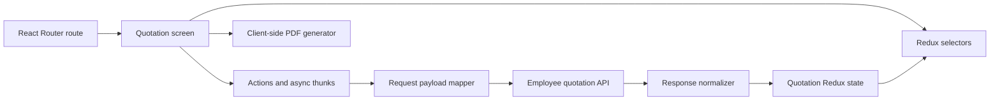
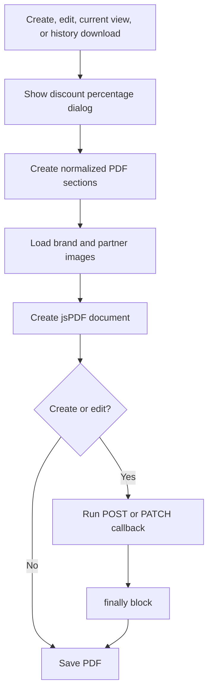

# Quotation Feature Engineering Guide

This guide documents the employee quotation feature as it is implemented in the current codebase. It is organized by feature so a new developer can understand each workflow, find its source files, and identify every layer that may need to change during future development.

The primary feature lives in:

- `src/components/screen/quotations`
- `src/store/quotation`
- `src/api/employee/quotation.api.js`
- `src/api/factories/quotation.factory.js`

> There is also a separate product-screen quick quotation implementation under `src/components/screen/products/quotation` and `src/store/product/quotation`. It does not use the primary quotation creation and update workflow documented here.

## Feature index

| Feature | Main responsibility |
| --- | --- |
| [Access and routes](#1-access-and-routes) | Employee authorization and page entry points |
| [Quotation list](#2-quotation-list) | Search, pagination, row actions, and list loading |
| [Create quotation](#3-create-quotation) | Company, product, summary, persistence, and PDF workflow |
| [Company information](#4-company-information) | Company directory, manual details, validation, and tax inference |
| [Product information](#5-product-information) | Product directory, product lines, discounts, duplicates, and editing |
| [Quotation summary](#6-quotation-summary) | Commercial fields, totals, notes, and submission |
| [PDF generation](#7-pdf-generation) | Branded PDF data mapping, layout, pagination, and download |
| [View quotation](#8-view-quotation) | Current quotation details and PDF download |
| [Quotation history](#9-quotation-history) | History normalization, comparison, display, and historical PDFs |
| [Edit quotation](#10-edit-quotation) | Form hydration, update rules, and revision numbering |
| [Exit protection](#11-exit-protection) | Navigation blocking and workflow reset behavior |
| [Keyboard navigation](#12-keyboard-navigation) | Desktop shortcuts, focus order, and dialogs |
| [Redux state](#13-redux-state) | State subdomains, reducers, selectors, and async requests |
| [API contracts](#14-api-contracts) | Endpoints, outbound payloads, and response normalization |
| [Business calculations](#15-business-calculations) | Price, discount, tax, and final amount rules |
| [Development recipes](#16-development-recipes) | Safe steps for common enhancements |
| [Testing checklist](#17-testing-checklist) | Recommended regression coverage |
| [Known constraints](#18-known-constraints) | Current technical limitations and risks |
| [File reference](#19-file-reference) | High-value source files by responsibility |

## Architecture overview



| Layer | Responsibility | Location |
| --- | --- | --- |
| Routing | Role protection and page entry points | `src/App.jsx`, `src/routes/navigate.js` |
| Screens | Forms, tables, dialogs, viewing, and downloads | `src/components/screen/quotations` |
| State | Workflow, table, directory, submission, and view state | `src/store/quotation` |
| API | Employee endpoint access | `src/api/employee/quotation.api.js` |
| API factory | GET, POST, PATCH, and response unwrapping | `src/api/factories/quotation.factory.js` |
| Mapping | Backend/frontend field conversion | `quotation.api-response.js`, `quotation.api-payload.js` |
| PDF | Data sections, layout, calculations, and browser download | `src/components/screen/quotations/downloadPdf` |

---

## 1 Access and routes

The primary quotation feature is available only to users with the employee role. The routes are nested inside an employee-only `RoleRoute` in `src/App.jsx`.

| Route | Screen | Purpose |
| --- | --- | --- |
| `/quotations` | `QuotationsPage` | Quotation list |
| `/quotations/new` | `CreateQuotationPage` | Create workflow |
| `/quotations/:quotationId/view` | `ViewQuotationPage` | Current details and history |
| `/quotations/:quotationId/edit` | `EditQuotationPage` | Update workflow |

Route constants and builders are defined in `src/routes/navigate.js`:

- `ROUTES.QUOTATIONS`
- `ROUTES.QUOTATION_NEW`
- `ROUTES.QUOTATION_VIEW`
- `ROUTES.QUOTATION_EDIT`
- `ROUTE_BUILDERS.quotationView`
- `ROUTE_BUILDERS.quotationEdit`

Breadcrumb labels for create, view, and edit are built in `src/routes/private.route.jsx`.

### When changing routes

Update all of the following when a route path or parameter changes:

1. `src/routes/navigate.js`
2. `src/App.jsx`
3. `src/routes/private.route.jsx`
4. Navigation calls in quotation screens
5. Any keyboard shortcut that navigates away from a quotation page

---

## 2 Quotation list

### Entry points

- Page: `src/pages/quotations.page.jsx`
- Screen: `src/components/screen/quotations/index.jsx`
- Table hook: `src/components/screen/quotations/table/useQuotationTable.js`
- Table configuration: `src/components/screen/quotations/table/quotationTable.config.js`
- Columns: `src/components/screen/quotations/table/quotationTable.columns.jsx`

### Workflow

1. `Quotations` calls `useQuotationTable`.
2. The hook delegates generic table behavior to `useDataTable`.
3. `fetchQuotationDetails` reads page, limit, search, sort, and filters from `state.quotation`.
4. The thunk converts table settings with `toQuotationListParams`.
5. `employeeQuotationApi.getQuotationDetails` calls the employee quotation endpoint.
6. `fromQuotationListResponse` normalizes records and pagination.
7. Table reducers store the normalized rows and request status.

### Row actions

Each row provides:

- **View**: navigates to the view route and passes the quotation in router state.
- **Edit**: checks `quotation.isUpdateAvailable` before navigating.
- **Keyboard row action**: opens `QuotationRowActionDialog` with both choices.

Editing is blocked when any raw quotation product lacks a recognized product or Tally product reference. The UI then opens `QuotationUpdateUnavailableDialog`.

### List request rules

- Only the employee role is accepted by `fetchQuotationDetails`.
- Search, sort, pagination, and filters use the shared list-query format.
- The default quotation sort array is empty.
- The row key uses `quotation.id`, falling back to `quotation.quotationNumber`.
- The search placeholder is “Search by company or quotation number...”.

### Files commonly changed with this feature

- `src/store/quotation/table/quotationTable.state.js`
- `src/store/quotation/table/quotationTable.reducers.js`
- `src/store/quotation/table/quotationTable.selectors.js`
- `src/components/screen/quotations/table/quotationTable.api-payload.js`
- `src/components/screen/quotations/table/quotationTableActions.jsx`

---

## 3 Create quotation

### Entry points

- Page: `src/pages/create-quotation.page.jsx`
- Screen: `src/components/screen/quotations/create/index.jsx`
- Step renderer: `src/components/screen/quotations/form/createQuotationForm.jsx`

### Workflow states

The step values are defined by `CREATE_QUOTATION_STEPS` in `src/enums/quotation.enum.js`:

```text
company-information
        ↓
product-information
        ↓
quotation-summary
        ↓
discount visibility dialog
        ↓
generate PDF + POST quotation
        ↓
quotation list
```

| Step | Component | Main result |
| --- | --- | --- |
| Company information | `QuotationCompanyForm` | Saves the selected or entered company and infers tax treatment |
| Product information | `QuotationProductInformation` | Builds `productInformation` with one or more lines |
| Quotation summary | `CreateQuotationSummary` | Reviews commercial details and starts submission |

### Create submission

`useDownloadQuotationPdf` coordinates the create operation:

1. It verifies that company information and at least one product exist.
2. It opens the discount visibility dialog.
3. It builds the PDF input from Redux state.
4. `downloadQuotationPdf` creates the PDF document.
5. Before browser save, it dispatches `createQuotationDetails` using the generated quotation reference.
6. The PDF is saved in a `finally` block.
7. A successful POST sets the submission success flag.
8. `useQuotationPageKeyboardShortcut` navigates back to `/quotations`.
9. The quotation state resets when the completed page unmounts.

### Important create behavior

The PDF still downloads when the create API request fails. Redux keeps the API error and the workflow does not navigate as a successful submission, but `doc.save` still runs.

---

## 4 Company information

### Entry points

- Form: `src/components/screen/quotations/form/companyInformation/quotationCompanyForm.jsx`
- UI: `src/components/screen/quotations/form/companyInformation/index.jsx`
- Directory hook: `companyInformation/companyDirectory/useQuotationCompanyDirectory.js`
- Search hook: `companyInformation/hooks/useQuotationCompanySearch.js`
- Response mapping: `src/store/quotation/quotation-company-directory.api-response.js`

### Company sources

A quotation company may come from:

- The active employee company directory
- Manually typed company information
- Existing quotation data during edit hydration

Selecting a directory company copies its values into Formik. Clearing it removes the Redux selection and resets the form.

### Stored fields

```js
{
  companyName,
  address,
  email,
  phoneNumber,
  gstNumber
}
```

The selected directory reference is stored separately as `selectedCompany`. This distinction lets the quotation preserve a company ID while also saving a snapshot of the displayed company information.

### Validation

Validation is in `quotationForm.validation.schema.js` and reuses company validation constants.

| Field | Rule |
| --- | --- |
| Company name | Required; shared minimum and maximum length |
| Address | Required; shared minimum and maximum length |
| Email | Optional; valid email within shared length limits |
| Phone | Optional; shared 10-digit phone pattern |
| GST number | Optional; uppercased and must match the shared GST pattern |

### Automatic tax treatment

When company information is saved:

- If the lowercased address contains `gujarat`, tax treatment becomes `gujarat`.
- Otherwise tax treatment becomes `out of gujarat`.

The summary screen can change this inferred value later.

### Directory requests

- Only active companies are requested with `is_active: true`.
- The directory page size is 100.
- First-page requests replace existing options.
- Later pages merge by company ID.
- Request IDs prevent stale responses from overwriting a newer search.
- Aborted requests do not show an error.

---

## 5 Product information

### Entry points

- Screen: `src/components/screen/quotations/form/productInformation/index.jsx`
- Main behavior hook: `productInformation/useQuotationProductInformation.js`
- Form: `productInformation/quotationProductForm.jsx`
- Utilities: `productInformation/quotationProductInformation.utils.js`
- Redux thunk helpers: `src/store/quotation/product/quotationProduct.thunks.js`
- Redux reducers: `src/store/quotation/product/quotationProduct.reducers.js`

### Product line model

A saved frontend line may contain:

```js
{
  lineId,
  quotationVersion,
  productId,
  productSource,
  product,
  quantity,
  sellingPrice,
  discount,
  discountPercentage,
  description,
  finalPrice,
  hsnCode,
  productCode,
  category,
  agency,
  modelNumber
}
```

Create-time lines may have fewer display fields than response-normalized lines.

### Directory and manual products

- Selecting a directory product copies its form values and preserves its ID.
- Typing the exact name of a directory product can resolve that product automatically.
- A manual product can be saved without a directory ID if it passes validation.
- Existing product metadata is preserved while editing when the product name is unchanged.

### Product validation

| Field | Rule |
| --- | --- |
| Product | Required; maximum length from shared product validation |
| Selling price | Required, numeric, greater than zero, within shared maximum |
| Quantity | Required whole number from 1 to 1,000,000 |
| Discount amount | Optional, numeric, non-negative, not above selling price |
| Discount percentage | Optional, numeric, from 0 to 100 |
| Description | Optional; shared maximum length |

### Discount synchronization

The form supports editing either representation:

```text
discount amount = selling price × discount percentage ÷ 100

discount percentage = discount amount ÷ selling price × 100
```

Calculated commercial values are rounded to two decimal places and stored as strings in the form.

### Duplicate detection

`findDuplicateProductIndex` detects a duplicate when either condition is true:

- Both lines have non-null product IDs and the IDs match.
- Trimmed, lowercased product names match.

The product currently being edited is excluded from the search.

### Product actions

- Add another product
- Open the saved-product summary
- Edit a saved product
- Request and confirm deletion
- Detect and open an existing duplicate
- Restore the directory description
- Navigate to company information
- Navigate to quotation summary

### Unsaved product protection

When product form fields contain data, navigation to company information, product summary, or quotation summary first opens a discard dialog. Confirming discard resets Formik and product editing state before navigation.

### Product directory requests

- The page size is 100.
- First-page requests replace products.
- Later pages merge by product ID.
- Request IDs prevent stale results from winning.
- The product directory uses the employee product API and the product-list default sort.

---

## 6 Quotation summary

### Entry points

- Shared layout: `src/components/screen/quotations/form/quotationSummary/index.jsx`
- Create wrapper: `quotationSummary/createQuotationSummary.jsx`
- Edit wrapper: `quotationSummary/editQuotationSummary.jsx`
- Behavior hook: `quotationSummary/useQuotationSummary.js`
- Calculations: `quotationSummary/quotationSummary.utils.js`

### Summary sections

The summary presents and edits:

- Tax treatment
- GST percentage
- Delivery notes
- Payment notes
- Bill-to company information
- Product information
- Final bill details
- Back and submit actions

Delivery and payment notes are converted to uppercase by Redux reducers.

### Tax treatments

Defined in `src/enums/quotation.enum.js`:

| Value | Display label | GST behavior |
| --- | --- | --- |
| `gujarat` | Gujarat | GST applies |
| `out of gujarat` | Out of Gujarat | GST applies |
| `SEZ LUT` | SEZ LUT | GST is zero |

### Submission guards

Create and edit submission return without doing anything when:

- A submission is already running.
- Company information is missing.
- No product lines exist.
- Edit mode has no quotation ID.

---

## 7 PDF generation

### Entry points

- Orchestration: `src/components/screen/quotations/downloadPdf/downloadQuotationPdf.js`
- Section mapping: `downloadPdf/quotationPdfSections.js`
- Document creation: `downloadPdf/pdf/createQuotationPdfDocument.js`
- Constants and helpers: `downloadPdf/pdf/pdf.constants.js`, `downloadPdf/pdf/pdf.utils.js`
- Render sections: `downloadPdf/sections`

### PDF flow



### PDF sections

`createQuotationPdfSections` produces:

```js
{
  quotationRefId,
  quotationDate,
  company,
  products,
  commercial,
  enquiryContact
}
```

### Document behavior

- Uses jsPDF with millimetres and A4 pages.
- Uses a provided quotation reference or generates one.
- Uses the provided quotation date or the current date.
- Loads company and partner logos as data URLs.
- Continues without an image when image loading fails.
- Paginates products based on available page height.
- Moves totals to a new page when necessary.
- Adds a footer to every page.
- Optionally shows the discount-percentage column.
- Saves the filename after replacing `/` characters in the reference with `-`.

### Persistence and download ordering

Create and edit pass an API function as `beforeSave`. The document is already generated before this callback runs. PDF save occurs in `finally`, so API failure does not prevent download.

| Context | Reference source | API operation |
| --- | --- | --- |
| Create | Generated PDF reference | POST before download |
| Edit | Current or incremented revision reference | PATCH before download |
| Current view | Stored quotation reference | None |
| History view | Historical or reconstructed reference | None |

### Discount visibility dialog

The same `QuotationPdfDiscountDialog` is used by create, edit, current-view, and history downloads.

- **Yes** includes the Discount (%) column.
- **No** omits the Discount (%) column.
- **Y** and **N** provide keyboard shortcuts.

---

## 8 View quotation

### Entry points

- Page: `src/pages/view-quotation.page.jsx`
- Screen: `src/components/screen/quotations/viewQuotationInformation/index.jsx`
- Current view: `viewQuotationInformation/currentVersion/currentQuotationDetails.jsx`
- Shared details: `viewQuotationInformation/quotationDetails/quotationDetails.jsx`

### Quotation resolution

`ViewQuotationPage` tries these sources in order:

1. Quotation passed in router state
2. Matching quotation already in the Redux list
3. A quotation-list fetch, followed by another lookup

The key is `id`, falling back to `quotationNumber`.

### Display sections

- Company details
- Current quotation details
- Quotation history
- Current-version PDF download

Only one top-level information accordion is open at a time. The open section is stored in `state.quotation.viewOpenSection`.

### PDF download status

Each current or historical PDF download uses a key built from available quotation ID, number, and version. Status values are:

- Missing: idle
- `downloading`: disable button and show spinner
- `error`: show retry title

---

## 9 Quotation history

### Entry points

- History list: `viewQuotationInformation/history/quotationHistory.jsx`
- History entry: `history/quotationHistoryEntry.jsx`
- History details: `history/quotationHistoryDetails.jsx`
- Normalization and comparison: `viewQuotationInformation/viewQuotationInformation.utils.js`

### Supported backend history shapes

The history utility accepts:

- Complete quotation snapshot objects
- Individual historical product rows containing fields such as `qty`, `unit_price`, and `final_price`

Individual product rows are grouped by creation timestamp into a quotation snapshot before normalization.

### History processing

1. Group product-row history when necessary.
2. Normalize each snapshot with `fromQuotationResponse`.
3. Resolve a quotation version.
4. Sort versions from oldest to newest.
5. Compare each version with its previous version.
6. Reverse the result so the newest history appears first.

### Compared quotation fields

- Company name
- Address
- Email
- Phone number
- GST number
- Tax treatment
- GST percentage
- Delivery notes
- Payment notes
- Notes

### Compared product fields

- Product name
- Quantity
- Unit price
- Discount
- Description
- HSN code
- Product code
- Category
- Agency
- Model number

Products can be marked as added, updated, or removed.

### Product comparison key

The first available value is used:

1. `productId`
2. Product name
3. `lineId`
4. Array index

### Historical PDF input

`createViewQuotationPdfInput`:

- Uses the history snapshot reference when it already contains `/R<number>/`.
- Otherwise rewrites the base quotation reference using the historical version.
- Chooses the best available changed, updated, or created date.
- Builds a temporary product directory from the historical product lines.
- Uses the updater or creator as the enquiry contact when available.

---

## 10 Edit quotation

### Entry points

- Page: `src/pages/edit-quotation.page.jsx`
- Screen: `src/components/screen/quotations/edit/index.jsx`
- Hydration hook: `edit/hooks/useEditQuotation.js`
- Update hook: `edit/hooks/useUpdateQuotationPdf.js`
- Revision logic: `edit/editQuotationRevision.utils.js`

### Entry requirement

`EditQuotationPage` looks for the quotation in the current quotation-list state. It redirects to `/quotations` when:

- The quotation is missing from the current list state.
- `isUpdateAvailable` is false.

### Hydration

`quotationEditingStarted` resets form-related state and copies:

- Quotation ID
- Quotation reference
- Quotation version
- Original GST percentage
- Selected company
- Company snapshot
- Tax treatment
- Current GST percentage
- Delivery notes
- Payment notes
- Current product lines
- Original product lines

Edit begins at the product-information step. Company information is not exposed as an editable step.

### Revision-sensitive changes

A new revision is created when:

- GST percentage changes.
- Product count changes.
- Product order changes.
- A product line changes in product ID, product source, quantity, selling price, or discount.

A new revision is **not** created by the current comparison when only these values change:

- Product description
- Product delivery notes
- Tax treatment
- Delivery notes
- Payment notes

### Revision numbering

When a revision-sensitive change exists:

- `V<number>` increments by one.
- `/R<number>/` in the quotation reference increments by one.

If there is no revision-sensitive change, both values remain unchanged.

### Update submission

1. Resolve whether a new revision is necessary.
2. Generate a PDF using the resolved quotation reference.
3. Dispatch `updateQuotationDetails` through the PDF `beforeSave` callback.
4. Map the update state to a PATCH payload.
5. Save the PDF even if PATCH fails.
6. Navigate to the list only when the Redux update succeeds.

---

## 11 Exit protection

### Entry point

`src/components/screen/quotations/keyboardShortcuts/page/useQuotationPageKeyboardShortcut.js`

Create and edit install a React Router blocker while submission has not succeeded.

### Behavior

- A route change opens `QuotationExitDialog`.
- **Discard and exit** resets the quotation slice and proceeds.
- **Keep and exit** proceeds without resetting; this choice is available in create mode.
- Closing the dialog cancels the blocked navigation.
- Escape on the quotation summary returns to product information.
- Escape on another step navigates to the quotation list, which then triggers the blocker.
- After successful submission, navigation to the list is automatic and the state resets on unmount.

When adding a new completion path, ensure it sets or respects submission success so navigation is not incorrectly blocked.

---

## 12 Keyboard navigation

### Reference configuration

`src/components/screen/quotations/keyboardShortcuts/quotationKeyboardShortcuts.config.js`

### Main shortcuts

| Context | Shortcut behavior |
| --- | --- |
| Quotation list | `Alt+N` opens a new quotation; `Escape` returns to dashboard |
| Company name | Arrow keys enter the directory; `Alt+Right` focuses it |
| Company directory | Arrow keys move options; `Left` returns to the name field |
| Product name | Arrow keys enter the directory; `Alt+Right` focuses it |
| Product directory | Arrow keys move options; `Left` returns to the name field |
| Product form | `Alt+Z` restores the original directory description |
| Form fields | `Alt+Up`, `Alt+Down`, `Enter`, and `Tab` move through fields |
| Previous field | `Backspace` or `Delete` can move backward before editing |
| Product summary | `Enter` edits; `Delete` requests delete; `Alt+N` adds; `Alt+D` opens summary |
| Quotation summary | Keyboard traversal across sections and actions; `Escape` returns to products |
| Dialogs | Arrow keys or `Tab` move; `Enter` confirms; `Escape` closes |
| PDF dialog | `Y` includes discount percentage; `N` hides it |
| View quotation | `Tab` and `Shift+Tab` traverse sections and history; `Escape` returns to list |

### Development rule

When a form field is added or reordered, update:

1. Its React ref
2. The field component prop
3. The relevant keyboard hook
4. The previous and next field references
5. `aria-keyshortcuts` when applicable
6. Focus restoration after dialogs
7. The shortcut reference configuration when user-visible behavior changes

---

## 13 Redux state

The quotation slice is assembled from smaller state factories and reducer modules, but all values live under `state.quotation`.

### State subdomains

| Subdomain | Representative state | Responsibility |
| --- | --- | --- |
| Table | Rows, pagination, search, sort, filters, row action | Quotation list |
| Editor | Step, edit source, tax, GST, notes, exit dialog | Create/edit workflow |
| Company | Directory, search, selection, company snapshot | Company step |
| Product | Directory, saved lines, original lines, pending actions | Product step |
| Submission | Loading, success, error, returned quotation | POST and PATCH lifecycle |
| View | Open accordion and keyed PDF statuses | View page |

### State construction

`src/store/quotation/quotation.state.js` combines:

- `createQuotationTableState`
- `createQuotationViewState`
- `createQuotationEditorState`
- `createQuotationSubmissionState`
- `createQuotationCompanyState`
- `createQuotationProductState`

`quotationReset` rebuilds the entire state. Local form resets should use narrower actions such as `quotationProductFormReset`.

### Async thunks

Defined in `src/store/quotation/quotation.action.js`:

- `fetchQuotationDetails`
- `fetchQuotationCompanies`
- `fetchQuotationProducts`
- `createQuotationDetails`
- `updateQuotationDetails`

All thunks verify that the current auth role is employee before performing the request.

### Request race protection

Company and product directory state keeps the latest Redux Toolkit request ID. Fulfilled or rejected results are ignored when their request ID is no longer current.

---

## 14 API contracts

### Endpoint surface

The path is built as:

```text
/{rolePath}/{ENDPOINTS.QUOTATION.DETAILS}
```

For this feature, `rolePath` is the employee role path.

| Operation | Method | Path |
| --- | --- | --- |
| List | GET | `/employee/quotation-details` |
| Create | POST | `/employee/quotation-details` |
| Update | PATCH | `/employee/quotation-details/:quotationId` |

### Response unwrapping

The API factory supports:

- Raw list arrays
- Wrapped list objects
- Single mutation objects
- One-element mutation arrays

Recognized wrapped-list keys include:

- `quotation_details`
- `quotationDetails`
- `quotations`
- `items`
- `pagination`

### Create payload

Built by `toQuotationDetailsCreatePayload`:

```js
{
  quotation_ref_id,
  company,
  company_name,
  company_address,
  company_email,
  company_phone_number,
  company_gst_number,
  tax_type,
  gst,
  delivery_notes,
  payment_notes,
  products
}
```

Create product lines use quotation version `V1` and select either `product` or `tally_product` from `productSource`.

### Update payload

The update payload has the same top-level shape. When a revision-sensitive
change exists, every product line receives the newly resolved quotation
version. For metadata-only updates, `quotation_version` is omitted from each
product line so the backend leaves the stored version unchanged.

Current behavior explicitly passes `product` as the product reference field during update, even when a normalized source product originated from `tally_product`.

### Product payload

```js
{
  product: productId,
  // or tally_product during create
  quotation_version,
  description,
  qty,
  unit_price,
  discount,
  final_price
}
```

Normalization rules:

- Invalid numbers become zero.
- Unit price cannot be negative.
- Discount is clamped between zero and unit price.
- `final_price` is the per-unit price after discount.
- Blank optional text becomes `null`.

### Response normalization

`src/store/quotation/quotation.api-response.js` is the compatibility boundary for backend response shapes.

It supports:

- Snake-case and camelCase fields
- Scalar IDs and populated reference objects
- `product` and `tally_product` references
- Several company reference aliases
- Several quotation list wrapper shapes
- Explicit version, product-line version, or version parsed from `/R<number>/`

Prefer adding a new backend alias here instead of adding defensive field checks to UI components.

### Normalized quotation model

The main result contains:

```js
{
  id,
  company,
  selectedCompany,
  companyName,
  companyInformation,
  quotationNumber,
  quotationVersion,
  taxTreatment,
  gstPercentage,
  deliveryNotes,
  paymentNotes,
  notes,
  products,
  productInformation,
  isUpdateAvailable,
  quotationHistory,
  createdBy,
  createdAt,
  updatedBy,
  updatedAt
}
```

---

## 15 Business calculations

### Quotation totals

Implemented in `quotationSummary/quotationSummary.utils.js`:

```text
sale price total = sum(unit selling price × quantity)

discount total = sum(per-unit discount × quantity)

taxable amount = max(sale price total - discount total, 0)

total tax = taxable amount × GST percentage ÷ 100

final amount = taxable amount + total tax
```

GST is applied only for Gujarat and Out of Gujarat tax treatments. SEZ LUT uses a zero GST rate.

### Per-product values

```text
per-unit final price = unit price - per-unit discount

product line total = per-unit final price × quantity
```

### Calculation locations

Commercial logic currently exists in more than one layer:

- Quotation summary totals
- API product payload mapping
- Quotation PDF utilities and sections
- The separate product-screen quick quotation PDF

When changing pricing, tax, discount, or rounding, verify every in-scope calculation path.

---

## 16 Development recipes

### Add a quotation-level field

1. Decide whether it belongs to editor, company, product, submission, table, or view state.
2. Add its default to the correct state factory or Formik initial values.
3. Add Yup validation and messages when editable.
4. Add an action and selector when stored in Redux.
5. Add it to create and update payload mapping.
6. Add response aliases to `fromQuotationResponse`.
7. Hydrate it in `quotationEditingStarted`.
8. Add it to summary and view UI.
9. Decide whether it affects totals, revisions, history badges, or PDF output.
10. Add keyboard navigation if it is an interactive field.
11. Test create, edit, view, history, and PDF contexts.

### Add a product-line field

1. Add the field to initial values.
2. Add validation and user-facing messages.
3. Add the input and keyboard refs.
4. Preserve it in selected-directory and existing-line mappings.
5. Add it to the product save object.
6. Map it to and from the API if persisted.
7. Add it to summary and view display.
8. Decide whether it triggers a new revision.
9. Add it to history comparison when meaningful.
10. Add it to PDF section mapping and layout when required.

### Change an API field

1. Change outbound mapping only in `quotation.api-payload.js`.
2. Change inbound aliases only in `quotation.api-response.js`.
3. Preserve old aliases during backend migration when possible.
4. Test raw arrays, wrapped lists, mutation objects, and one-element arrays.
5. Test both populated reference objects and scalar IDs.
6. Test both regular and Tally product sources.

### Change revision behavior

1. Update `editQuotationRevision.utils.js`.
2. Normalize numeric strings before comparison.
3. Decide whether product order is meaningful.
4. Verify reference and version increment together.
5. Test references without `/R<number>/`.
6. Align history badges if the same policy should be shown to users.

### Change PDF output

1. Start with `quotationPdfSections.js` for data changes.
2. Update the relevant renderer in `downloadPdf/sections`.
3. Update height calculations for any variable-height section.
4. Test both discount visibility modes.
5. Test every tax treatment.
6. Test long company addresses and product descriptions.
7. Test enough products to produce multiple pages.
8. Test missing image assets.
9. Test create, edit, current-view, and history downloads.

### Change keyboard behavior

1. Update the context-specific hook.
2. Check previous and next focus refs.
3. Preserve normal typing behavior.
4. Preserve dialog Escape behavior.
5. Update `aria-keyshortcuts`.
6. Update `quotationKeyboardShortcuts.config.js`.
7. Test focus restoration after closing dialogs.

---

## 17 Testing checklist

The reviewed repository does not currently contain quotation-specific automated tests or a test script. It provides `lint` and `build` scripts.

### Required project checks

```bash
npm run lint
npm run build
```

### Recommended automated unit coverage

- `fromQuotationResponse`
- `fromQuotationListResponse`
- `toQuotationDetailsCreatePayload`
- `toQuotationDetailsUpdatePayload`
- `toQuotationProductPayload`
- `calculateQuotationBillTotals`
- Discount amount and percentage conversion
- `findDuplicateProductIndex`
- `resolveEditQuotationRevision`
- `buildQuotationHistory`
- `getQuotationChanges`
- `createViewQuotationPdfInput`
- `createQuotationPdfSections`

### Manual regression matrix

- [ ] Employee can load the quotation list.
- [ ] Search and pagination work.
- [ ] List errors and retry work.
- [ ] View and edit row actions work with mouse and keyboard.
- [ ] Company directory search and pagination work.
- [ ] Manual company entry validates correctly.
- [ ] Gujarat tax treatment is inferred from the address.
- [ ] Product directory and manual product entry work.
- [ ] Duplicate product detection works by ID and name.
- [ ] Product edit, delete, discard, and add-another dialogs work.
- [ ] Discount amount updates percentage.
- [ ] Discount percentage updates amount.
- [ ] All three tax treatments calculate correctly.
- [ ] Create success persists, downloads, redirects, and resets.
- [ ] Create failure displays an error and still downloads the PDF.
- [ ] Edit hydration preserves the original quotation.
- [ ] Revision-sensitive edits increment reference and version.
- [ ] Description-only edits do not increment the revision.
- [ ] Update failure displays an error and still downloads the PDF.
- [ ] Current quotation view renders all sections.
- [ ] Both supported history response shapes render correctly.
- [ ] Current and historical PDFs download independently.
- [ ] Multi-page PDFs keep products, totals, and footers readable.
- [ ] Keyboard focus order remains correct on every step.
- [ ] Exit protection works for browser and in-app navigation.

---

## 18 Known constraints

### Edit deep links depend on existing list state

`EditQuotationPage` does not fetch a quotation by ID. Refreshing or opening an edit URL directly can redirect to the list because the required quotation is absent from Redux.

**Future direction:** add a quotation-detail endpoint or route loader.

### View fallback fetches a list, not a detail

When a view quotation is missing, the page fetches the quotation list and searches the returned rows. A record outside the returned page may remain unavailable.

**Future direction:** fetch a single quotation by route ID.

### PDF downloads after persistence failure

The PDF save occurs in `finally`, so a user can receive a PDF for a quotation that was not saved to the backend.

**Future direction:** keep this behavior only if it is an explicit business requirement; otherwise save after API success or visibly mark the PDF as unpersisted.

### Update forces the regular product reference

Create respects `productSource`, but update currently forces the `product` payload field.

**Future direction:** confirm the backend contract and preserve `tally_product` during update when required.

### Revision reference requires a matching token

`nextQuotationReference` only increments references containing `/R<number>/`. A nonconforming reference can receive a new `V<number>` without a changed reference.

**Future direction:** validate quotation references or implement a fallback reference builder.

### Revision comparison is order-sensitive

Products are compared by array index. Reordering otherwise identical product lines creates a new revision.

**Future direction:** retain this if display order is commercially meaningful; otherwise compare by stable line identity.

### Revision and history policies differ

History badges compare more fields than the edit revision helper. For example, notes or product descriptions can appear as changes even though they do not create a new revision in edit logic.

**Future direction:** document this as intentional or centralize the change policy.

### Empty product arrays appear updateable

`isUpdateAvailable` uses `quotationProducts.every(...)`. JavaScript returns `true` for `every` on an empty array.

**Future direction:** require at least one product when updateability should imply a valid editable quotation.

### Separate quotation implementations can drift

The product-screen quick quotation has separate state, calculations, validation, and PDF code.

**Future direction:** consolidate only the business rules and PDF contracts that are genuinely shared.

### No quotation-specific automated tests

Financial, revision, and normalization changes currently depend heavily on manual testing.

**Future direction:** begin with pure utility tests before adding workflow integration tests.

---

## 19 File reference

### Routing

| Purpose | File |
| --- | --- |
| Route declarations and role guards | `src/App.jsx` |
| Route constants and builders | `src/routes/navigate.js` |
| Breadcrumbs and private layout | `src/routes/private.route.jsx` |

### Pages and screens

| Purpose | File |
| --- | --- |
| List page | `src/pages/quotations.page.jsx` |
| Create page | `src/pages/create-quotation.page.jsx` |
| View page | `src/pages/view-quotation.page.jsx` |
| Edit page | `src/pages/edit-quotation.page.jsx` |
| List screen | `src/components/screen/quotations/index.jsx` |
| Create screen | `src/components/screen/quotations/create/index.jsx` |
| Edit screen | `src/components/screen/quotations/edit/index.jsx` |
| View screen | `src/components/screen/quotations/viewQuotationInformation/index.jsx` |

### Forms

| Purpose | File |
| --- | --- |
| Create step renderer | `form/createQuotationForm.jsx` |
| Edit step renderer | `form/editQuotationForm.jsx` |
| Initial values | `form/quotationForm.initialValues.js` |
| Validation schema | `form/quotationForm.validation.schema.js` |
| Validation constants | `form/quotationForm.validation.constants.js` |
| Validation messages | `form/quotationForm.validation.messages.js` |
| Company form | `form/companyInformation/quotationCompanyForm.jsx` |
| Product workflow hook | `form/productInformation/useQuotationProductInformation.js` |
| Product utilities | `form/productInformation/quotationProductInformation.utils.js` |
| Summary calculations | `form/quotationSummary/quotationSummary.utils.js` |

All form paths above are relative to `src/components/screen/quotations`.

### Redux

| Purpose | File |
| --- | --- |
| Root quotation slice | `src/store/quotation/quotation.slice.js` |
| Root state composition | `src/store/quotation/quotation.state.js` |
| Async thunks | `src/store/quotation/quotation.action.js` |
| Selector exports | `src/store/quotation/quotation.selector.js` |
| Outbound payloads | `src/store/quotation/quotation.api-payload.js` |
| Inbound normalization | `src/store/quotation/quotation.api-response.js` |
| Company state and reducers | `src/store/quotation/company` |
| Product state and reducers | `src/store/quotation/product` |
| Editor state and reducers | `src/store/quotation/editor` |
| Submission state and reducers | `src/store/quotation/submission` |
| Table state and reducers | `src/store/quotation/table` |
| View state and reducers | `src/store/quotation/view` |

### API

| Purpose | File |
| --- | --- |
| Employee quotation API | `src/api/employee/quotation.api.js` |
| Quotation API factory | `src/api/factories/quotation.factory.js` |

### PDF

| Purpose | File |
| --- | --- |
| Create download hook | `downloadPdf/useDownloadQuotationPdf.js` |
| Discount dialog hook | `downloadPdf/useQuotationPdfDiscountDialog.js` |
| Download orchestrator | `downloadPdf/downloadQuotationPdf.js` |
| PDF input sections | `downloadPdf/quotationPdfSections.js` |
| jsPDF document builder | `downloadPdf/pdf/createQuotationPdfDocument.js` |
| PDF helpers | `downloadPdf/pdf/pdf.utils.js` |
| PDF constants | `downloadPdf/pdf/pdf.constants.js` |
| PDF section renderers | `downloadPdf/sections` |
| View PDF input | `viewQuotationInformation/quotationDetails/viewQuotationPdf.utils.js` |
| View PDF button | `viewQuotationInformation/quotationDetails/quotationPdfDownloadButton.jsx` |

PDF paths above are relative to `src/components/screen/quotations`.

### Revision, history, and keyboard behavior

| Purpose | File |
| --- | --- |
| Edit revision rules | `src/components/screen/quotations/edit/editQuotationRevision.utils.js` |
| History normalization and comparison | `src/components/screen/quotations/viewQuotationInformation/viewQuotationInformation.utils.js` |
| Shortcut reference | `src/components/screen/quotations/keyboardShortcuts/quotationKeyboardShortcuts.config.js` |
| Exit blocker and page Escape behavior | `src/components/screen/quotations/keyboardShortcuts/page/useQuotationPageKeyboardShortcut.js` |

---

## Keeping this guide current

Update this file in the same change set whenever any of these areas change:

- Routes or role access
- Create or edit steps
- Redux state ownership
- API fields or response shapes
- Validation rules
- Pricing, discount, or tax calculations
- Revision rules
- PDF persistence or layout behavior
- History comparison
- Keyboard shortcuts
- High-value file locations

For significant changes, include the affected guide section in the pull request description.
